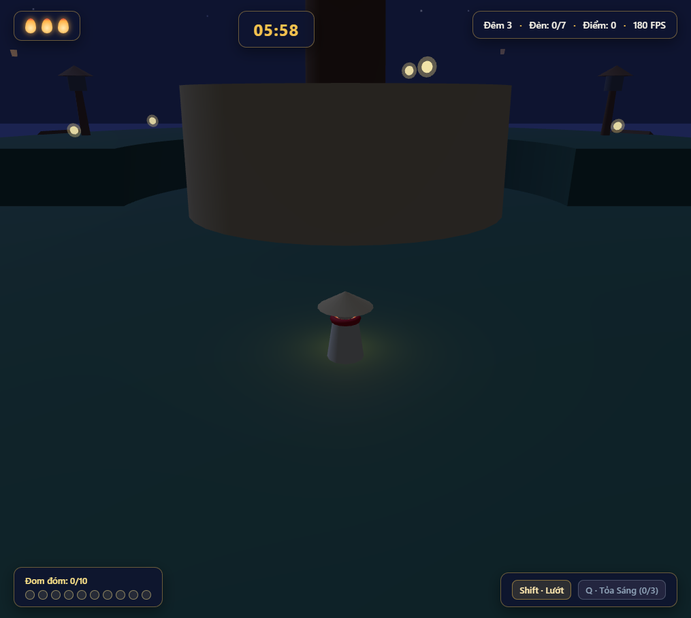

# Đảo Đèn Lồng (v1.0.0) — Day 12 AI SDLC Lab

> **Video demo (< 5 phút):** [Xem video demo trên Release v1.0.0](../../releases/tag/v1.0.0) *(hoặc `docs/demo/demo.mp4` sau khi tải lên)*



Game 3D góc nhìn thứ ba xây dựng hoàn chỉnh qua 4 phase theo quy trình AI SDLC: điều khiển **Mây** (người giữ đèn đội nón lá treo đèn lồng) qua **3 Đêm** (**Đảo Bến**, **Đảo Cau**, **Đảo Chuông**) thu thập **Đom Đóm**, thắp và châm dầu giữ sáng **Đèn Lồng Lớn** tới bình minh, sử dụng **Lướt**, **Tỏa Sáng**, **Bùa Gió** để đối phó **Bóng Mực** hút dầu và **Gió Lạc**.

## Yêu cầu hệ thống
- **Node.js ≥ 18** (khuyến nghị Node 20/22 LTS) trên **macOS / Linux / Windows**.
- Trình duyệt hỗ trợ WebGL2 (Chrome / Edge / Firefox / Safari).
- *(Tùy chọn)* Docker nếu muốn chạy qua container (`Dockerfile` có sẵn ở gốc repo).

## Cài đặt & Chạy (tối đa 3 lệnh)

```bash
npm ci
npm run build
npm start
```

Sau lệnh thứ 3 (`node dist-cli/cli/run.js`), mở trình duyệt tại `http://127.0.0.1:4173`.

*(Hoặc chạy qua Docker: `docker build -t dao-den-long . && docker run -p 4173:4173 dao-den-long`.)*

## Điều khiển mặc định (đổi được cả 9 phím trong Cài đặt)
| Phím | Hành động |
|---|---|
| `W / A / S / D` | Di chuyển (`6.0 m/s`; `7.2 m/s` khi có Bùa Gió) |
| `Space` | Nhảy (`7.0 m/s`, trọng lực `-20 m/s²`) |
| `Shift` | Lướt / Dash (`14 m/s`, `0.2 s`, hồi `1.5 s`, giữ độ cao trên không) |
| `E` | Nạp đom đóm / Thắp lại (`5`) / Châm dầu (`+10` fuel/đom đóm) |
| `Q` | Tỏa Sáng (tốn `3` đom đóm, bán kính 3D `5 m`, choáng `2 s` + đẩy `4 m`) |
| `Esc` hoặc `P` | Tạm dừng (đóng băng hoàn toàn logic) |
| Giữ chuột trái + kéo hoặc `← / →` | Xoay camera góc nhìn thứ ba |

## Luật chơi & Cách tính điểm (v1.0.0 — Contract v1.3)
- **Mục tiêu:** Giữ đủ đèn sáng tới lúc bình minh (`Đêm 1: ≥ 3/5 trong 240s`, `Đêm 2: ≥ 4/6 trong 270s`, `Đêm 3: ≥ 5/7 trong 300s`).
- **Nhiên liệu đèn:** Tối đa `100`, tự hao `1.0/s`; dưới `30` mất vùng an toàn và Bóng Mực `wander` sẽ hút thêm `5/s`; cạn dầu đèn tắt và thắp lại chỉ cần `5` đom đóm.
- **Sức chứa động:** `10 + 2 × số lần thắp thành công` (tối đa `20`, đặt lại mỗi Đêm).
- **Điểm số:** `+5` mỗi đom đóm nạp/châm · `+100` thắp lần đầu · `+40` thắp lại · `+5` mỗi Bóng Mực trúng Tỏa Sáng (`+15` nếu đang `drain`) · Thắng bình minh (`dawn_survived`): `+50 + floor(fuel)` cho mỗi đèn sáng + `+50` mỗi Ngọn Lửa còn lại.

## Lệnh Kiểm thử, Headless, Benchmark, Soak & Bảng xếp hạng

- **Chạy toàn bộ cổng kiểm chứng (typecheck + build + 31 test + determinism 3 Đêm + soak 10 Đêm + xuất leaderboard):**
  ```bash
  npm run verify
  ```
- **Chạy Unit & Regression Test:**
  ```bash
  npm test
  ```
- **Chế độ Headless (Test Contract v1.3, Đêm 1 / 2 / 3):**
  ```bash
  node dist-cli/cli/headless.js --seed 42 --night 1 --ticks 14400 --out tmp/out.jsonl --snapshot-every 10
  ```
- **Chế độ Benchmark 3D chuẩn 1280×720 (`bench.json`):**
  ```bash
  node dist-cli/cli/bench.js --seed 42 --duration 30 --out bench.json
  ```
  *(Tự động mở cửa sổ 1280×720 không toàn màn hình bằng Chrome/Chromium/Edge với cờ `--disable-gpu-vsync`, `vsync_off: true`; có thể chỉ định trình duyệt qua biến môi trường `BENCH_BROWSER`.)*
- **Soak Test 10 Đêm liên tiếp (`soak.json`):**
  ```bash
  node --expose-gc --max-semi-space-size=4 dist-cli/cli/soak.js --seed 7 --nights 10 --out soak.json
  ```
- **Xuất Bảng xếp hạng cục bộ (Top 10):**
  ```bash
  node dist-cli/cli/run.js --export-leaderboard out.json
  ```

## Trợ năng (Accessibility)
- **Bảng màu dễ phân biệt (Mù màu):** Đổi viền/mắt Bóng Mực sang `#00B3FF`, cảnh báo UI sang `#FFFFFF` kèm biểu tượng `⚠`; đèn tắt xẹp 20% có vết rách giấy; đèn `< 30` dầu nhấp nháy `1 Hz`.
- **Đổi phím đủ 9 hành động:** Phát hiện trùng phím tức thì, có nút **Khôi phục mặc định**, tự lưu bền vững.
- **Phụ đề & chỉ báo hình ảnh:** Hiện cảnh báo + mũi tên mép màn hình khi Bóng Mực xuất hiện, cảnh báo gió sắp thổi, 10 s cuối, và đèn cạn dầu `< 30%`.
- **Giảm chuyển động** (tắt rung camera & chớp màn hình) và **Cỡ chữ tối thiểu 18 px** ở `1280×720` kèm tùy chọn **Chữ lớn (×1.25)**.

## Sáng tạo của tôi
- **Không khí đêm cổ tích thuần lớp hiển thị (`src/game/`):**
  - Đèn hoa đăng vàng ấm trôi trên biển mây xa bờ và bầu trời sao.
  - Kiến trúc đặc trưng cho từng hòn đảo: cầu tàu gỗ Đảo Bến, nan tre trên cầu nối Đảo Cau, mái đỏ và chuông đồng trên Tháp Chuông Đảo Chuông, vầng hào quang Bùa Gió quanh Mây và lá vàng bay theo hướng gió.
  - Nhạc nền ngũ cung và 16 hiệu ứng âm thanh tổng hợp 100% bằng Web Audio API (`src/game/audio.ts`), cùng lời dẫn Ông Đăng mở đầu mỗi Đêm.
- **Bảo toàn tuyệt đối Test Contract & công bằng đo đạc:** Toàn bộ yếu tố sáng tạo nằm tách biệt trong `src/game/` và **tắt hoàn toàn** trong chế độ headless (`src/cli/headless.ts`), soak test (`src/cli/soak.ts`) và cảnh benchmark (`?bench=1` trong `src/game/benchMode.ts`).

## Tài liệu SDLC, Harness & Bằng chứng
- **Spec, Giả định & ADR:** `docs/notes/phase-1-spec.md`, `phase-2-spec.md`, `phase-3-spec.md`, `phase-4-spec.md`, `ADR-001-lantern-fuel-and-dawn-win.md`
- **Đánh giá từng phase & Retro tổng hợp:** `docs/notes/phase-1-eval.md` … `phase-4-eval.md`, `docs/notes/retro.md`
- **Bằng chứng thật khớp tag:** `docs/proof/phase-1/` … `docs/proof/phase-4/`, `bench.json`, `soak.json`
- **Harness AI:** `AGENTS.md`, `.agents/skills/verify-phase/SKILL.md`, `scripts/verify-gate.mjs`, `.github/workflows/ci.yml`
- **Lịch sử, Nguồn & Giấy phép:** `CHANGELOG.md`, `CREDITS.md`, `LICENSE`
